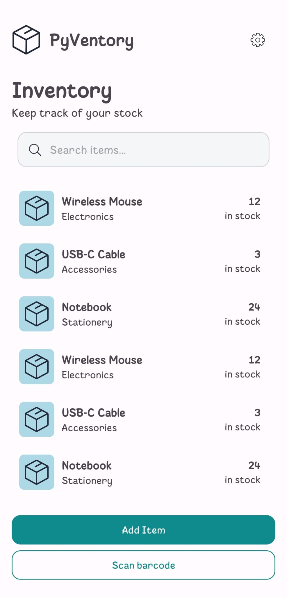
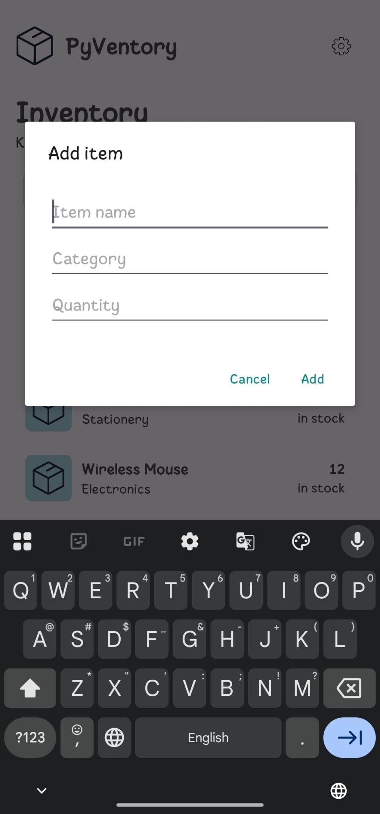
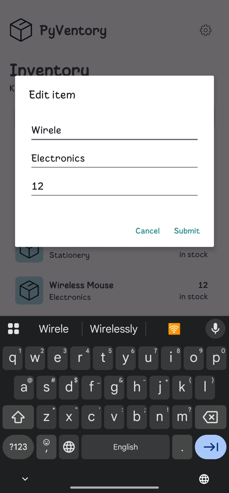

# PyVentory Mobile

An Android version of **PyVentory**, a personal inventory manager originally built as a Python desktop application.

Manage your inventory from your phone with a simple interface for viewing, adding, and editing items.

## About

PyVentory Mobile brings the original project's core functionality to Android and is part of my ongoing work to develop PyVentory across multiple platforms.

## Goals

- Bring core inventory management features to Android.
- Build a simple, intuitive mobile experience.
- Extend the functionality of the original desktop application.

## Screenshots

<table>
  <tr>
    <th>Main Page</th>
    <th>Add Item</th>
    <th>Edit Item</th>
  </tr>
  <tr>
    <td></td>
    <td></td>
    <td></td>
  </tr>
</table>

## Download APK

[Download the Android APK](https://github.com/ItzGoobers/Pyventory-Mobile/raw/refs/heads/master/app/app-debug.apk)

This is a debug build intended for testing.

## Project Status

### Work in Progress

The **Scan Barcode** and **Settings** buttons are currently placeholders and do not perform any actions. These features are still under development.

🚧 **Under development**

The current interface includes a main page and basic screens for adding and editing items. Features and functionality may change as development progresses.

## License

A license has not yet been specified. Licensing information will be added in a future update.
